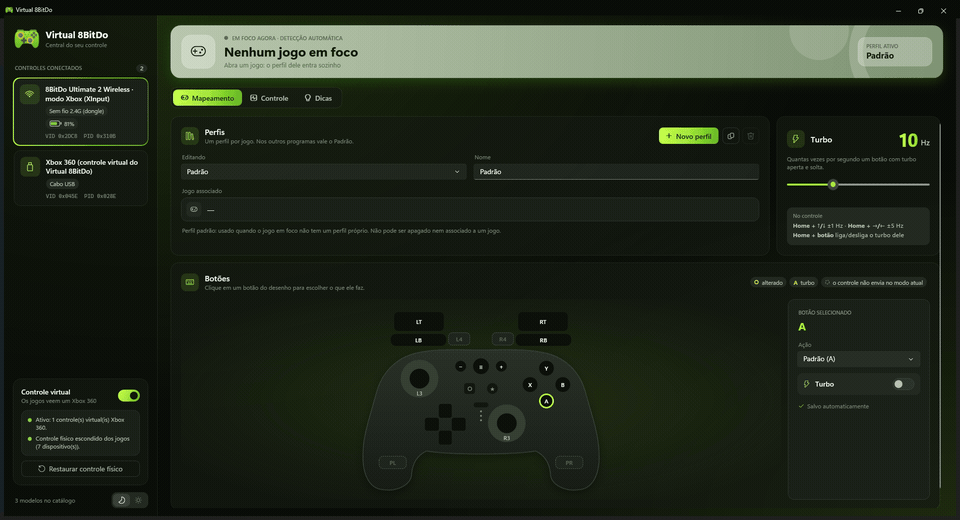
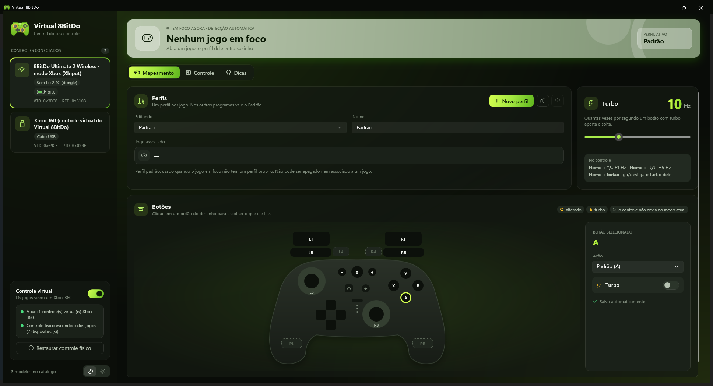
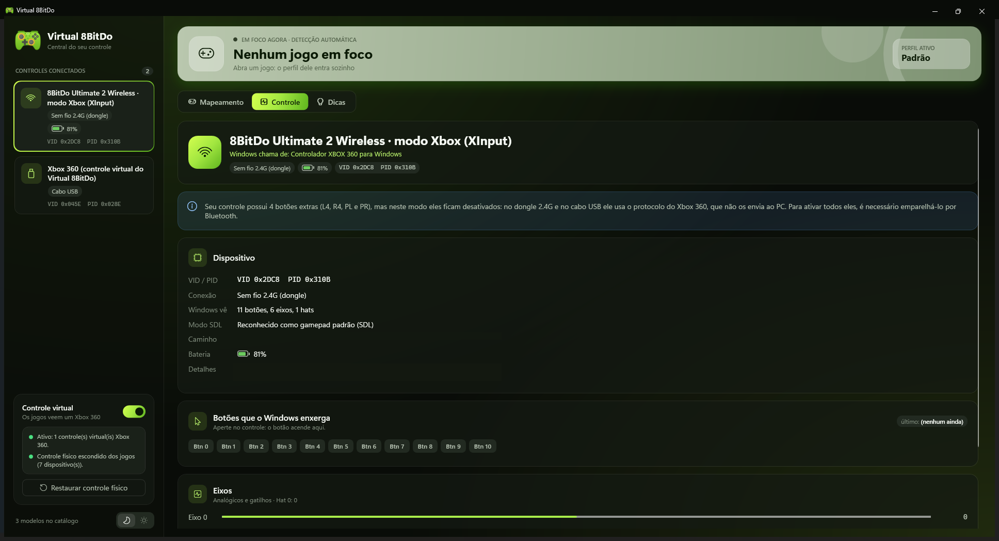
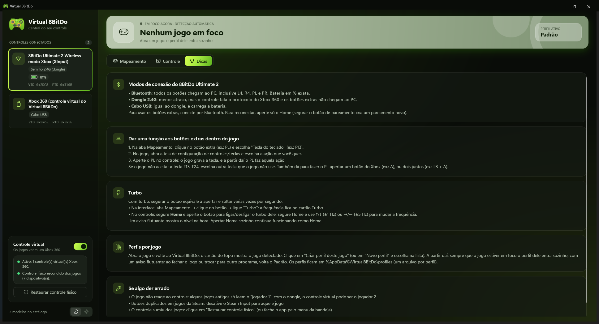
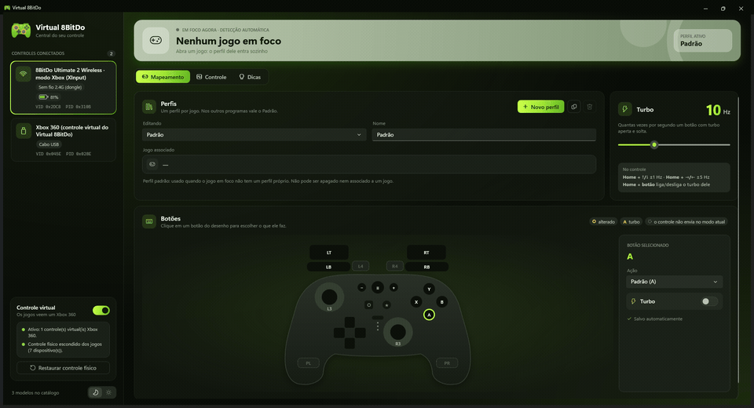
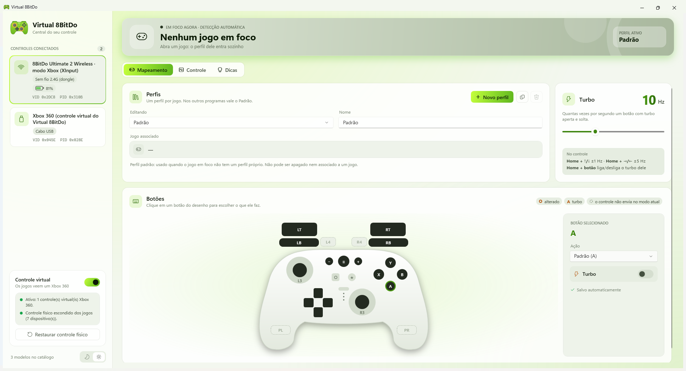

<div align="center">

# Virtual 8BitDo

**A central do seu controle 8BitDo no Windows.**
Perfis automáticos por jogo, mapeamento de botões, turbo, bateria e um controle virtual Xbox 360 que funciona em qualquer jogo.



</div>

---

## O que ele faz

- **Perfil automático por jogo.** Abriu o jogo, o perfil dele entra sozinho. Fechou, volta o perfil Padrão. Um aviso flutuante confirma a troca por cima do jogo.
- **Mapeamento de botões.** Clique em um botão no desenho do controle e escolha o que ele faz: outro botão do Xbox, dois botões juntos, ou uma tecla do teclado.
- **Turbo.** Por botão, de 1 a 30 Hz. Dá para ajustar também pelo próprio controle (Home + direcional).
- **Controle virtual Xbox 360.** O jogo enxerga um controle Xbox padrão, então funciona até em jogos que não conhecem o 8BitDo. O controle físico fica escondido dos jogos para os botões não duplicarem.
- **Bateria.** Nível em % e aviso de bateria baixa, mesmo com o app na bandeja.
- **Tema escuro e claro**, com troca na hora.

## Como é

### Mapeamento e turbo



Cada botão do desenho é clicável. Contorno âmbar = alterado, letra âmbar = turbo, tracejado = o controle não envia esse botão no modo de conexão atual. As mudanças são salvas sozinhas.

### Informações do controle



Modelo reconhecido, modo de conexão (cabo, dongle 2.4G ou Bluetooth), bateria, e os botões e eixos que o Windows enxerga, ao vivo.

### Dicas



Guia rápido dentro do app: modos de conexão, como dar função aos botões extras, turbo e o que fazer se algo der errado.

### Tema escuro e claro



O escuro é o padrão. A troca é na hora, pelo botão lua/sol no canto da barra lateral, e a escolha fica salva.

<details>
<summary>Tema claro</summary>



</details>

## Requisitos

- **Windows 10 ou 11** (64 bits). Alguns detalhes visuais, como a cor da barra de título, só aparecem no Windows 11.
- **[ViGEmBus](https://github.com/nefarius/ViGEmBus)** — **obrigatório** para o controle virtual. Sem ele o app funciona só como visualizador e monitor de bateria.
- **[HidHide](https://github.com/nefarius/HidHide)** — **recomendado**. Sem ele o jogo enxerga o controle físico e o virtual ao mesmo tempo, e os botões podem duplicar.

Você não precisa baixar os drivers à mão: se algum faltar, o app mostra o botão **"Instalar ... (oficial)"**. Ele baixa o instalador do GitHub oficial do projeto, confere a assinatura digital (Nefarius Software Solutions e.U.) e só então abre. O Windows vai pedir a sua confirmação (UAC).

## Controles testados

| Controle | Conexão | Observação |
|---|---|---|
| 8BitDo Ultimate 2 Wireless | Dongle 2.4G / cabo USB (modo Xbox) | 11 botões chegam ao PC. L4, R4, PL e PR **não** chegam. |
| 8BitDo Ultimate 2 Wireless | Bluetooth | Todos os 15 botões, inclusive os extras. Bateria em % exata. |

Os botões **Estrela** (turbo do controle) e **Screenshot** não são enviados ao PC em nenhum modo, então nenhum software consegue lê-los.

Outros controles que o Windows reconhece como gamepad padrão aparecem na lista e funcionam como "genérico". Para cadastrar um modelo novo, edite `src/Virtual8BitDo.Catalog/models.json`.

## Como usar

1. Abra o Virtual 8BitDo e conecte o controle (cabo, dongle ou Bluetooth).
2. Abra o jogo. O cartão do topo mostra o que foi detectado.
3. Clique em **"Criar perfil deste jogo"**. Daqui em diante o perfil entra sozinho toda vez que o jogo estiver em foco.
4. Na aba **Mapeamento**, clique nos botões do desenho para mudar o que cada um faz.

Os perfis ficam em `%AppData%\Virtual8BitDo\profiles` (um arquivo JSON por perfil). Fechar a janela no X esconde o app na bandeja; para encerrar de verdade, use **Sair** no menu do ícone da bandeja.

> **Se o controle sumir dos jogos:** clique em **"Restaurar controle físico"** (ou feche o app pela bandeja). Isso desliga o repasse e mostra o controle físico de novo.

## Aviso sobre anti-cheat

O app cria um controle virtual (ViGEmBus), esconde o controle físico (HidHide) e pode simular teclas e turbo. Jogos com anti-cheat rígido, principalmente os competitivos online, podem bloquear esses recursos ou considerá-los suspeitos, e turbo e teclas simuladas podem violar as regras desses jogos. **Use por sua conta e risco.** Em jogos online competitivos, desligue o interruptor "Controle virtual" ou feche o app.

## Compilar

Precisa do [.NET 10 SDK](https://dotnet.microsoft.com/download).

```powershell
git clone https://github.com/Luc4sL4mou/virtual-8bitdo.git
cd virtual-8bitdo
dotnet build
dotnet test
dotnet run --project src/Virtual8BitDo.App
```

### Estrutura

| Projeto | Função |
|---|---|
| `Virtual8BitDo.Input` | Leitura dos controles (SDL3, XInput, USB) e consulta de bateria |
| `Virtual8BitDo.Catalog` | Catálogo de modelos conhecidos (`models.json`) |
| `Virtual8BitDo.Core` | Motor: mapeamento, turbo, perfis |
| `Virtual8BitDo.Output` | Controle virtual (ViGEm), HidHide e saída de teclado |
| `Virtual8BitDo.App` | Interface (WPF, tema Fluent do .NET 10) |
| `Virtual8BitDo.Tests` | Testes automatizados (xUnit) |

## Créditos e licenças

Este projeto só existe por causa do trabalho de outras pessoas. Obrigado a:

| Componente | Autoria | Licença |
|---|---|---|
| [ViGEmBus](https://github.com/nefarius/ViGEmBus) (driver) | Nefarius | BSD-3-Clause — projeto arquivado em 2023, mas ainda funciona |
| [HidHide](https://github.com/nefarius/HidHide) (driver) | Nefarius | MIT |
| [Nefarius.ViGEm.Client](https://github.com/nefarius/ViGEm.NET) | Nefarius | MIT — também arquivado |
| [SDL3](https://libsdl.org) | Equipe SDL | Zlib |
| [ppy.SDL3-CS](https://github.com/ppy/SDL3-CS) (binding .NET) | ppy | MIT |
| [HidSharp](https://www.zer7.com/software/hidsharp) | James F. Bellinger | Apache 2.0 ([texto da licença](http://www.zer7.com/files/oss/hidsharp/LICENSE.txt)) |
| [8bitdo-ultimate2-linux](https://github.com/MiguelSanzBr/8bitdo-ultimate2-linux) | MiguelSanzBr | MIT — fonte da consulta de bateria no modo Xbox, obtida por engenharia reversa |

Virtual 8BitDo não é afiliado nem endossado pela 8BitDo, pela Microsoft ou pelos autores acima. "8BitDo" e "Xbox" são marcas de seus respectivos donos.
